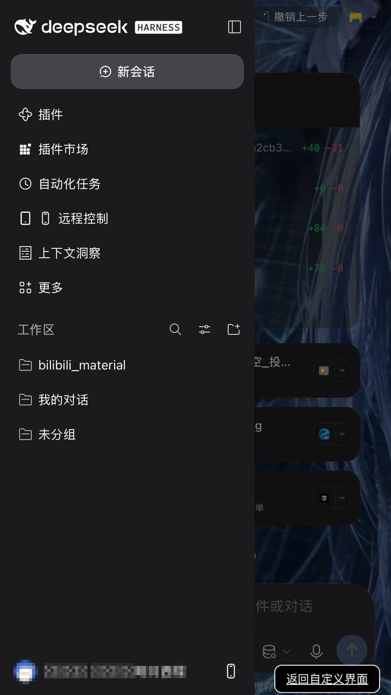
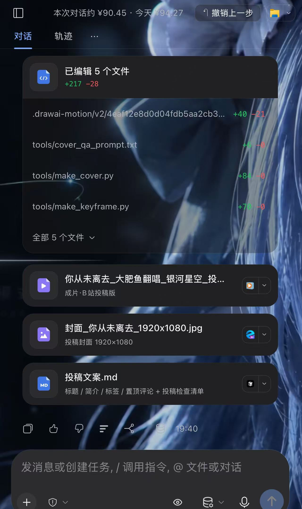
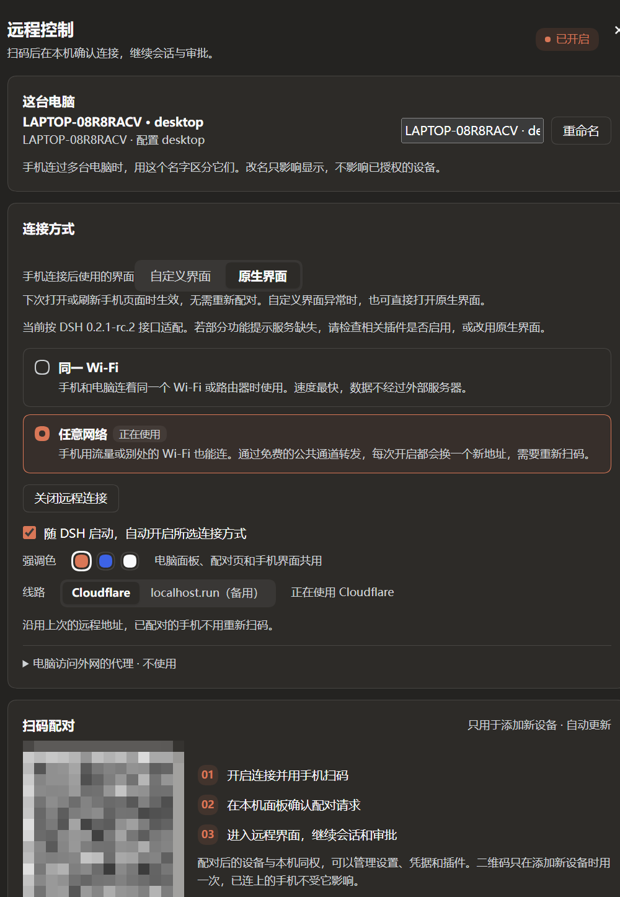
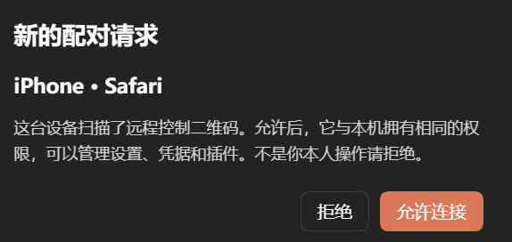

# dsh-remote-control

[](https://awesome-dsh-plugin.com)
[](LICENSE)

**中文** | [English](#english)

DeepSeek Harness（DSH）的远程控制插件：手机扫码、在电脑上确认后，用手机浏览器继续自己电脑上的会话、处理审批、查看文件和管理设置。电脑上的桌面应用和 `dsh web` 界面保持原样。

Remote control for DeepSeek Harness (DSH): scan a QR code with your phone, confirm once on the computer, then keep working on that computer's sessions from the phone browser — including approvals, files and settings. The desktop app and the `dsh web` UI stay exactly as they are.

| 手机端：侧栏与工作区 | 手机端：会话、文件与输入区 |
|---|---|
|  |  |

| 电脑端：选择连接方式并显示配对二维码 | 新设备扫码后，在电脑上确认 |
|---|---|
|  |  |

> 以上截图都是本项目维护者自己截取后做了打码处理的：电脑面板上的配对二维码、手机侧栏里的头像与昵称已遮蔽。Screenshots are the maintainer's own, with the pairing QR code and the account avatar / nickname redacted.

> **项目来历**：按本仓库维护者的说明，这份插件最初在这台电脑的 DSH 桌面版里做起，后来在 DSH 懒人版里一点点完善至今；逐文件比对也显示当前源码与一个第三方公开仓库（`copylee711/dsh-remote-control`，最后标签 `v0.2.9`）的早期快照同源、且明显更长（详见 [项目来历与授权说明](docs/provenance.md)）。本仓库由 [liuyong0426](https://github.com/liuyong0426) 在自己的账号下继续维护，不主张拥有该第三方账号；技术比对只说明代码关系，不对权属作结论。按 MIT 的要求，`LICENSE` 里的原始版权声明 `Copyright (c) 2026 Copy` 原样保留，并补上本仓库维护部分的版权行。详见 [归属声明](NOTICE)。

## 功能

| 功能 | 说明 |
| --- | --- |
| 两种连接方式 | “同一 Wi‑Fi”：手机与电脑在同一网络内直连。“任意网络”：经 Cloudflare Quick Tunnel 获得一个临时公网地址，不需要账号和域名 |
| 备用线路 | “任意网络”可改走 localhost.run（使用系统自带的 `ssh`，不下载任何组件）。实测速度很慢，只在 Cloudflare 开不起来时手动选用 |
| 扫码配对、本机确认 | 新设备扫码后进入等待页，电脑上弹出配对请求，允许后才能访问。新设备的首次批准只能在电脑上完成 |
| 设备管理 | 查看已授权设备（显示机型和连接方式）、重命名、撤销单台或全部设备 |
| 多台电脑 | 一台手机可以记住多台电脑（或多账户）的远程地址，在侧栏顶部点电脑名字即可切换；每台电脑有自己的名字，可在电脑面板里改 |
| 手机界面 | 可选自定义移动界面或 DSH 原生界面；自定义界面提供会话抽屉、底部输入区、分类设置及主题切换，异常提示中可直接转到原生界面 |
| 会话 | 新建、搜索、重命名、归档与恢复；选择工作区、模型、思考强度、Agent 和权限模式；Markdown、代码、表格、图片、附件、停止生成、工具审批、提问与方案确认 |
| 文件 | 浏览工作区，预览文本和图片，下载文件；在输入区上传附件 |
| 管理 | 宿主设置、凭据、插件安装与启停、定时任务、技能目录、工作区和远程设备 |
| 断线提示 | 手机与电脑失去联系时，界面顶部主动提示，恢复后自动重新读取状态；发送、审批、安装等写操作不会自动重放 |
| 强调色 | 陶土橙、蓝色、黑色三选一，电脑面板、配对页、手机界面以及同套 DSH 插件共用同一个选择 |
| 完成提醒 | 会话在后台跑完或停下来等你处理时，会话列表显示小圆点（实心＝已完成，空心＝在等你答），页签标题带上条数。在电脑设置页打开「完成提醒」后，切到别的页面时会再弹一条系统通知并轻震一下；通知需要安全连接，局域网 http 下只有页内圆点和页签计数 |
| 添加到主屏幕 | 配对页和远程页带自己的名字「DSH 远程」和 PNG 图标（含 iOS 用的 180px 图标），从 Safari／Chrome 添加到主屏幕后是独立图标，不会装成宿主的「DeepSeek Harness」 |
| 掉线后从 QQ / IM 重连 | 只要你的 IM 机器人（QQ 机器人、QQ 助手、个人号机器人、飞书／钉钉／企微机器人等）能把聊天消息交给插件，在聊天里发一句「重连」或「远程状态」，插件就会把新的配对链接和二维码发到聊天里，并**自动放行一次**扫码——不用回电脑点「允许连接」。不限定某个特定机器人，也不要求装 `dafeiyu-qq`。详见 [从 QQ / IM 机器人重连](#从-qq--im-机器人重连) |

## 安装

> **当前状态**：npm 包 `@liuyong0426/dsh-remote-control` 还没发布；早期公开版本用的 `@copylee/dsh-remote-control` 属于第三方账号，本仓库不使用它。**从源码安装现在就能用**，npm 安装命令等首次发布后再启用，步骤见 [发布说明](docs/publishing.md)。

### 从源码安装（现在可用）

```bash
git clone https://github.com/liuyong0426/dsh-remote-control.git
cd dsh-remote-control
pnpm install --frozen-lockfile
pnpm build
```

然后在 DSH 桌面版「插件 → 添加插件」里填本仓库目录路径（以 link 方式安装），`pnpm build` 后重启 DSH 生效；`dsh web` 等其他 profile 同理。桌面应用和 `dsh web` 使用各自的 profile，需要分别安装。

### 从 npm 安装（发布后可用）

DSH 桌面版：**插件 → 添加插件**，输入 `@liuyong0426/dsh-remote-control`，安装后启用。

命令行（`dsh web` 等其他 profile）：

```bash
dsh plugin --profile web add @liuyong0426/dsh-remote-control@latest
```

要求：自插件 0.2.8 起，DSH 最低版本为 0.2.1-rc.2，Node.js 22.19+ 或 24+。“任意网络”需要电脑能访问 Cloudflare；手机不需要代理。

手机默认界面可在「设置 → 远程控制 → 手机连接后使用的界面」选择，刷新手机页面后生效，无需重新配对。自定义界面的设置页及错误提示提供「打开原生界面」。也可在已配对的网关地址后加 `/?ui=native` 临时打开原生界面，或用 `/?ui=custom` 返回自定义界面；临时切换不修改默认选项，两种界面使用相同的配对和撤销权限。

## 使用

左侧栏面板列表里，**「插件」和「自动化」下面**有「远程控制」一项，点它就在中间打开整页面板；左侧栏底部的手机图标和 **设置 → 远程控制** 打开的是同一份内容。

1. 选择“同一 Wi‑Fi”或“任意网络”，点击“开启远程连接”。“任意网络”首次开启会下载 Cloudflare 的连接组件，并在确认公网地址可用后才显示二维码。
2. 用手机扫描二维码，或打开复制的链接。
3. 电脑上弹出配对请求，确认设备名称后点“允许连接”。
4. 手机进入远程界面。

二维码只用于配对新设备，有效期 5 分钟，点击二维码可以刷新；已配对的手机不受二维码过期影响。

配对后是否需要重新扫码：

- “同一 Wi‑Fi”：授权保存在手机浏览器里，电脑重启连接后会尽量沿用上次的端口，手机打开原地址即可继续使用；连续 30 天不使用后授权过期。
- “任意网络”：每次开启都会换一个新地址，浏览器不会把旧地址的授权带到新地址，所以需要重新扫码并在电脑上确认。关闭连接时，这类设备记录会自动清除。

“关闭远程连接”会断开所有手机并保留“同一 Wi‑Fi”设备的授权；“撤销”立即断开对应设备并使其授权失效。已连接时改用另一种连接方式会先询问，确认后才断开当前连接。

### 用一台手机连多台电脑

一台手机可以记住多台电脑的远程地址，例如家里和公司的两台电脑，或同一台电脑上的两个 DSH 账户（每个 profile 各自一套授权）。切换只是换一个正在看的电脑，每台电脑上的会话、文件和工作区仍然各自独立。

- 添加：在另一台电脑上开启远程连接，用手机扫它的二维码配对一次。手机记住当前电脑的同时会带上已知的电脑列表，配对页和远程界面都会把列表合并进来，两边来回切换一次后列表就齐全了。
- 切换：手机界面侧栏顶部的电脑名字（例如 `LAPTOP-08R8RACV · desktop`）点开就是电脑列表，显示“正在使用”的那台是当前电脑，点其他电脑即可切换。列表里还提供重命名（只改手机上的叫法）、复制完整地址和移除。
- 名字：每台电脑第一次开启远程连接时自动生成一个名字（计算机名 + profile 名），可在电脑面板的“这台电脑”一栏改名。配对页会显示“连接 <名字>”，扫码前就能确认连的是哪台。
- 断线时：顶部提示条里除了“重试”，还会出现“切换到其他电脑”，方便在原来那台关机或换了地址时直接换过去。
- 地址变了怎么办：“任意网络”每次开启都会换地址，旧地址的授权也随之失效。手机侧栏的列表会保留这台电脑的新地址（切换回来时自动更新）；从别的电脑过来时，旧地址会被新地址替换而不是重复添加。

想手动加一台不在手边的电脑，也可以在列表里点“添加另一台电脑”，粘贴配对链接或直接粘贴地址（`192.168.x.x:端口` 会按同一 Wi‑Fi 的 HTTP 地址处理，公网域名按 HTTPS 处理）。用 HTTPS 访问时还可以点“扫描电脑上的二维码”直接调用相机扫码；HTTP 的局域网地址和 iOS Safari 不支持网页扫码，请用系统相机扫。

### 从 QQ / IM 机器人重连

“任意网络”每次开启都会换一个新地址，掉线后原来的链接就失效了；人在外面时，往往还得回到电脑跟前点一下「开启」再扫码确认。如果电脑上装了 IM 机器人（QQ 机器人、QQ 助手、QQ 个人号机器人，或者飞书／钉钉／企微等其它 IM 机器人），就能省掉这一步。

**不限定某个特定机器人。** 插件不绑定任何一家 IM 实现，只要求「机器人收到消息后，把这句话交给插件问一句」——QQ 机器人、QQ 助手、个人号机器人、第三方 IM 机器人都可以，**不需要装 `dafeiyu-qq`**，装了别的机器人同样生效（`dafeiyu-qq` 只是目前已知接好了这条通道的一个例子）。

1. 电脑上装好任意一个 IM 机器人插件，并绑定到自己的账号（QQ 号、飞书、钉钉、企微等，取决于那个机器人插件）。
2. 在聊天里对机器人发一句 **「重连」**（也认「重新连接」「远程重连」「远程掉线了」「reconnect」「rc」）。想先看看状态就发 **「远程状态」**（也认「远程连接」「remote status」）。
3. 插件在后台判断隧道是否还活着：好的就沿用旧地址，坏的就重开一条；等新地址生效后**重新生成配对二维码**，由机器人把二维码图片和链接一起发回聊天。
4. 手机直接点链接或扫聊天里的码，**5 分钟内点开就自动通过**，不用回电脑点「允许连接」；过期了再发一次「重连」即可。

几条边界，写清楚免得误解：

- 自动放行**只对一次扫码生效**：插件只批准第一个到达的配对请求，批准后立即撤销这道门；5 分钟没扫就自动作废。窗口、审批弹窗等其它环节仍然照旧，不会自动同意。
- 这道门是插件自己开的，只在这条「IM 里要来的重连」路径上生效；平时在电脑面板上手动开启的连接不会自动批准任何设备。
- **没有“远程截图”功能**：发「二维码 / 扫码 / 截图」时，机器人发的是插件**自己画出来的配对二维码图片**，不是电脑屏幕截图。插件不提供、也不打算提供截屏能力。
- 生效的前提只有一条：**机器人把这句话交给插件**。插件对外开了两个入口，任何机器人插件（自己写也行）用其中一个接上就生效：
  - 同进程插件：`const rc = ctx.get('dshRemoteControl')`，然后调用 `await rc.status()` / `await rc.reconnect()` / `await rc.fresh()` / `await rc.arm(5)` 等方法（完整签名见 `src/index.ts` 的 `RemoteControlService`）。
  - 拿不到 service registry 的 bundle：调用 `globalThis.__dshRcSay(text)`，它只认上面那几句指令，其它文本返回 `undefined`，交还给机器人自己处理。
  - 如果机器人插件没接这两个入口之一，发这些词不会有特别反应；机器人本身的安装、登录和授权属于那个插件的范围，本插件只负责「开门、出码、放行一次」。用之前可以先问一下机器人作者有没有接 `dshRemoteControl` 服务或 `__dshRcSay` 钩子。

### 连接不上时

- “任意网络”开不起来：先确认电脑能访问 Cloudflare。面板的“电脑访问外网的代理”默认不使用代理；直连不通时可改为“自动检测系统代理”或手动填写 HTTP(S) 代理地址（不接受带用户名密码的地址）。走代理反而连不上时改回“不使用”。仍不行可把线路换成 localhost.run。
- “任意网络”停在“正在检查能否访问”很久：新拿到的公共地址需要先被 Cloudflare 发布到 DNS，有的网络要一分钟左右，插件会一直等到它生效（最多约 3 分钟），期间面板显示“公共地址正在生效，第一次使用需要等一会儿”。这是正常等待，不是失败。
- “同一 Wi‑Fi”打不开：确认手机与电脑在同一网络、路由器没有开启客户端隔离、手机没有开 VPN。Windows 防火墙可能拦截网关端口，需要在“Windows Defender 防火墙（高级安全）→ 入站规则”里手动允许面板显示的端口（TCP，建议限制为专用网络）。插件不会修改系统防火墙。

## 设置

| 选项 | 默认 | 说明 |
| --- | --- | --- |
| 连接方式 | 任意网络 | 同一 Wi‑Fi / 任意网络 |
| 随 DSH 启动 | 关 | 启动时自动开启所选连接方式，按 profile 保存 |
| 线路 | Cloudflare | Cloudflare / localhost.run（备用），只对“任意网络”有效 |
| 电脑访问外网的代理 | 不使用 | 不使用 / 自动检测系统代理 / 手动填写，只对“任意网络”有效 |
| 强调色 | 陶土橙 | 陶土橙 / 蓝色 / 黑色 |
| `gatewayPort`（插件配置项） | 自动 | 固定网关端口，便于维护防火墙规则 |

## 安全说明

- **已授权的设备与电脑本机权限相同**，可以管理设置、凭据和插件。只批准自己信任的设备。
- “任意网络”的 HTTPS 在 Cloudflare 边缘终止，本插件不提供端到端加密。“同一 Wi‑Fi”使用 HTTP，应只在可信网络中使用。
- 手机访问的是插件自己的认证网关，而不是 DSH 的端口。未配对的设备只能打开配对页，读不到任何宿主数据；网关在内部换用宿主凭据，原始凭据不会发给手机。
- 最多保存 32 台设备，超出时淘汰最久未使用且不在线的一台；同时最多等待 16 个配对请求。
- 关闭连接或撤销设备会立即中断对应的 HTTP、WebSocket 和 SSE 连接。
- 「从 QQ / IM 重连」的自动放行只批准一次扫码，窗口 5 分钟；它不会降低其它环节的确认要求，也不会把设备权限转给机器人。

## 数据与隐私

- 授权与偏好保存在 `$DSH_HOME/dsh-remote-control/<profile>/`（未设置 `DSH_HOME` 时为 `~/.dsh`）。设备文件只保存随机密钥的 SHA-256 校验值、设备名称和时间，不保存密钥本身。
- “任意网络”的流量经过 Cloudflare（或 localhost.run）的服务器转发；“同一 Wi‑Fi”的流量不出局域网。
- 插件不收集、不上传使用数据。

## 工作原理

```
手机浏览器
   │  HTTPS（任意网络：Cloudflare Quick Tunnel / localhost.run）或 HTTP（同一 Wi‑Fi）
   ▼
认证网关（本插件，独立端口）  配对、设备 cookie、来源检查、限速
   │  回环地址，换用宿主凭据
   ▼
DSH Host 的 Web 服务  /api/remote.mux（WebSocket）、/plugins/*、文件接口
```

- 手机界面是随插件发布的独立前端：它启动宿主的客户端服务来读写会话和设置，界面本身由插件渲染。
- Cloudflare Quick Tunnel 不支持 SSE，远程引导脚本把宿主的 `/plugins/events` 事件流改由 WebSocket 传输，保留事件顺序、`Last-Event-ID` 和重连。
- 第三方插件的设置页通过兼容容器显示，涉及 DSH 内部渲染接口；宿主升级改变该接口时，对应页面会提示不可用，其余功能不受影响。0.2.8 的客户端运行时及内置原生前端已对齐 0.2.1-rc.2。
- QQ / IM 重连走的是插件进程内的另一道门：插件把「重连 / 远程状态」的处理挂在一个进程内入口上，IM 插件收到主人的消息后先问它一句；归它管就由它开隧道、出新码、放行一次，不交给模型。

更多细节见 [功能对应清单](docs/features.md)、[验证记录](docs/verification.md)、[调研记录](docs/research.md) 和 [UI 规格](docs/ui-spec.md)。

项目的其他说明：[更新日志](CHANGELOG.md)、[贡献指南](CONTRIBUTING.md)、[行为准则](CODE_OF_CONDUCT.md)、[安全策略](SECURITY.md)、[获取帮助](SUPPORT.md)、[发布说明](docs/publishing.md)、[项目来历与授权说明](docs/provenance.md)、[归属声明](NOTICE)。想在论文或作业里引用，见 [CITATION.cff](CITATION.cff)。

## 开发

```bash
pnpm install
pnpm typecheck
pnpm test          # vitest：网关、配对、宿主集成
pnpm build
node scripts/check-package.mjs   # 检查打包内容
```

`pnpm qa:host` 在仓库的 `.qa/` 目录里启动一个隔离的 DSH Web profile，不触碰日常使用的 DSH 配置；`pnpm qa:browser` 用本机 Chrome 跑完整回归（配对、会话、文件、设置、撤销）。回归使用的测试模型只返回固定内容，不发出外部请求。

本地联调：DSH 桌面版“添加插件”里填本仓库目录路径（以 link 方式安装），`pnpm build` 后重启 DSH 生效。

> 在已经跑着 DSH 的终端里跑测试时，先清掉 `DSH_PROFILE` / `DSH_HOME`，否则插件会把数据目录解析成当前 profile 而不是测试用的临时目录。

## 致谢

实现时参考了 [dsh-remote-web-ui](https://github.com/zhu1090093659/dsh-web/tree/main/packages/dsh-remote-web-ui)、[DSH Remote](https://github.com/mrRisega/dsh-remote/tree/main/packages/dsh-remote-web) 和 [untun](https://github.com/unjs/untun)。本项目为独立实现，不使用这些项目作者的中继服务。

## 许可证

MIT，完整文本见 [LICENSE](LICENSE)。

早期公开快照同样以 MIT 发布，`LICENSE` 中的 `Copyright (c) 2026 Copy` 按原许可要求原样保留；本仓库维护与新增部分的版权行为 `Copyright (c) 2026 liuyong0426`。第三方声明、保留的旧协议键与截图来源见 [NOTICE](NOTICE)，来龙去脉见 [docs/provenance.md](docs/provenance.md)。

---

## English

Remote control for DeepSeek Harness (DSH). Scan a QR code with your phone, approve it once on the computer, and then keep using that computer's DSH from the phone browser: continue sessions, answer approvals, browse files and change settings. The desktop app and the `dsh web` UI are left untouched.

### Features

| Feature | What it does |
| --- | --- |
| Two connection modes | **Same Wi‑Fi**: the phone talks to the computer directly on the local network. **Any network**: a temporary public address from a Cloudflare Quick Tunnel — no account, no domain |
| Fallback route | **Any network** can use localhost.run instead (via the system `ssh`; nothing is downloaded). Measured speed is poor, so it is a manual fallback for when Cloudflare will not come up |
| QR pairing, approval on the computer | A new device lands on a waiting page and the computer shows a pairing request. The first approval of a new device can only happen on the computer |
| Device management | List approved devices (model and connection mode), rename them, revoke one or all |
| Multiple computers | One phone can remember the addresses of several computers (or several DSH accounts) and switch from the sidebar; each computer has its own name, editable in the desktop panel |
| Phone UI | Either the custom mobile UI or DSH's native UI. The custom one has a session drawer, bottom composer, grouped settings and theme switching, and can jump to the native UI from an error notice |
| Sessions | Create, search, rename, archive and restore; pick workspace, model, reasoning effort, agent and permission mode; Markdown, code, tables, images, attachments, stop generation, tool approvals, questions and plan confirmations |
| Files | Browse the workspace, preview text and images, download files, upload attachments from the composer |
| Management | Host settings, credentials, plugin install/enable, scheduled tasks, skills, workspaces and remote devices |
| Offline notice | When the phone loses the computer, a banner appears and state is re-read once it is back. Write actions (send, approve, install) are never replayed automatically |
| Accent colour | Terracotta, blue or black, shared by the desktop panel, pairing page, phone UI and sibling DSH plugins |
| Completion badges | Sessions that finished in the background or are waiting for you get a dot in the list (filled = done, hollow = waiting) and a count in the tab title. With **Completion notifications** enabled in the desktop settings you also get a system notification and a haptic tap when you switch away; notifications need a secure connection, so over plain-HTTP LAN you only get the dot and the count |
| Add to home screen | The pairing and remote pages ship their own name ("DSH 远程") and PNG icons (including the 180 px iOS one), so adding them to the home screen gives a separate app rather than the host's "DeepSeek Harness" |
| Reconnect from QQ / IM | As long as your IM bot (a QQ bot, a QQ assistant, a personal-account bot, a Feishu / DingTalk / WeCom bot, …) can hand the chat message to the plugin, sending "重连" (reconnect) or "远程状态" (status) in the chat makes the plugin post a fresh pairing link and QR code into the chat and **auto-approve one scan** — no trip back to the computer. No particular bot is required and `dafeiyu-qq` is not needed. See [Reconnecting from QQ / IM](#reconnecting-from-qq--im) |

### Install

> **Status**: the npm package `@liuyong0426/dsh-remote-control` is not published yet; the earlier public `@copylee/dsh-remote-control` belongs to a third-party account and is not used by this repo. **Installing from source works today**; the npm command is enabled after the first release (see [publishing notes](docs/publishing.md)).

**From source (works now)**

```bash
git clone https://github.com/liuyong0426/dsh-remote-control.git
cd dsh-remote-control
pnpm install --frozen-lockfile
pnpm build
```

Then use **Plugins → Add plugin** in the DSH desktop app and point it at this directory (installed as a link), restart DSH after `pnpm build`. Other profiles (`dsh web`) work the same way. The desktop app and `dsh web` use separate profiles, so each needs its own install.

**From npm (after the first release)**

DSH desktop: **Plugins → Add plugin**, enter `@liuyong0426/dsh-remote-control`, then enable it.

Command line (other profiles, e.g. `dsh web`):

```bash
dsh plugin --profile web add @liuyong0426/dsh-remote-control@latest
```

Requirements: since 0.2.8 the plugin needs DSH 0.2.1-rc.2 or newer and Node.js 22.19+ or 24+. **Any network** needs the computer to reach Cloudflare; the phone needs no proxy.

The phone's default UI is chosen in **Settings → Remote control → UI used after connecting** and applies after a page refresh — no re-pairing. The custom UI's settings and error notices offer **Open native UI**. You can also append `/?ui=native` to a paired gateway address to open the native UI temporarily, or `/?ui=custom` to go back; a temporary switch does not change the saved default, and both UIs share the same pairing and revocation rules.

### Usage

The panel lives under **Plugins** and **Automation** in the sidebar panel list; clicking it opens the full page in the middle. The phone icon at the bottom of the sidebar and **Settings → Remote control** open the same content.

1. Pick **Same Wi‑Fi** or **Any network** and click **Enable remote control**. The first **Any network** run downloads the Cloudflare component and only shows a QR code once the public address is confirmed reachable.
2. Scan the QR code with the phone, or open the copied link.
3. A pairing request appears on the computer; check the device name and click **Allow**.
4. The phone enters the remote UI.

The QR code is only for pairing new devices and lives five minutes; click it to refresh. Already-paired phones are unaffected by its expiry.

Do you need to scan again?

- **Same Wi‑Fi**: the authorization lives in the phone browser. After a restart the plugin reuses the previous port where it can, so the old address keeps working; the authorization expires after 30 days of no use.
- **Any network**: every start yields a new address, and a browser does not carry authorization from an old address to a new one — so you scan again and confirm on the computer. Devices of this kind are cleared when the connection is closed.

**Disable remote control** disconnects every phone but keeps **Same Wi‑Fi** authorizations; **Revoke** disconnects a device immediately and invalidates its authorization. Switching connection modes while connected asks first and only disconnects after you confirm.

#### One phone, several computers

A phone can remember the addresses of several computers — home and office, or two DSH accounts on one machine (each profile has its own authorization set). Switching only changes which computer you are looking at; sessions, files and workspaces stay independent per computer.

- **Add**: enable remote control on the other computer and pair it once by scanning its QR code. The phone merges the known-computer list from both sides, so one round trip makes the list complete.
- **Switch**: tap the computer name at the top of the phone sidebar (e.g. `LAPTOP-08R8RACV · desktop`) to see the list; the one marked "in use" is current, tap another to switch. The list also offers rename (phone-side label only), copy full address and remove.
- **Names**: each computer gets a name on its first enable (computer name + profile name) and you can rename it under **This computer** in the desktop panel. The pairing page shows "Connect to <name>" so you can confirm the target before scanning.
- **When offline**: besides **Retry**, the banner offers **Switch to another computer** so you can move on when the old one is off or changed address.
- **Address changes**: every **Any network** start changes the address and invalidates the old one. The phone list keeps the new address for that computer (updated when you switch back); coming from another computer, the old entry is replaced rather than duplicated.

To add a computer that is not at hand, tap **Add another computer** in the list and paste a pairing link or a bare address (`192.168.x.x:port` is treated as an HTTP LAN address, a public domain as HTTPS). Over HTTPS you can also tap **Scan the QR code on the computer** to use the camera; plain-HTTP LAN addresses and iOS Safari cannot scan from a web page, so use the system camera there.

#### Reconnecting from QQ / IM

**Any network** changes address on every start, so a dropped link is dead; and when you are away from the computer you would otherwise have to walk back, click Enable and confirm the scan. An IM bot on the computer removes that trip.

**No particular bot is required.** The plugin does not bind to any one IM product: it only needs a bot that hands an incoming message to the plugin. A QQ bot, a QQ assistant, a personal-account bot or any third-party IM bot all work — **`dafeiyu-qq` is not needed**, other bots work just as well (`dafeiyu-qq` is merely the one implementation known to have wired this door so far).

1. Install any IM bot plugin on the computer and bind it to your own account (QQ, Feishu, DingTalk, WeCom — whatever that bot supports).
2. In the chat, send the bot **"重连"** (reconnect; also accepts 重新连接, 远程重连, 远程掉线了, reconnect, rc). To check first, send **"远程状态"** (also 远程连接, remote status).
3. The plugin checks whether the tunnel is still alive: a healthy one keeps its address, a broken one is replaced. Once the new address is live it draws a **fresh pairing QR code** and the bot posts the image plus the link into the chat.
4. Tap the link or scan the code on the phone: **opening it within five minutes is approved automatically**, with no click on the computer. If it expires, send "重连" again.

Boundaries, so nothing is misunderstood:

- The automatic approval covers **exactly one scan**: the plugin approves the first pairing request that arrives and immediately disarms; if nothing scans within five minutes the window expires. Windows, approval dialogs and everything else behave as usual — nothing else is auto-accepted.
- That door is opened by the plugin itself and only on this "reconnect requested from IM" path; connections you start by hand in the desktop panel never auto-approve any device.
- **There is no remote-screenshot feature.** Saying "二维码 / 扫码 / 截图" makes the bot send the pairing QR code the plugin drew itself — not a screenshot of the computer. The plugin neither has nor plans screen capture.
- The only requirement is that **the bot hands the text to the plugin**. Two entry points are exposed, and any bot plugin (including one you write yourself) works by calling either:
  - In-process plugins: `const rc = ctx.get('dshRemoteControl')`, then `await rc.status()` / `await rc.reconnect()` / `await rc.fresh()` / `await rc.arm(5)` and the rest of `RemoteControlService` (full signature in `src/index.ts`).
  - Bundles that cannot reach this process's service registry: call `globalThis.__dshRcSay(text)`. It answers only the phrases above and returns `undefined` for anything else, so the bot can keep handling that text itself.
  - If the bot plugin wires neither, those words do nothing special. Installing, logging in and authorizing the bot are that plugin's business; this plugin only opens the door, draws the code and approves one scan. When in doubt, ask the bot's author whether it calls the `dshRemoteControl` service or the `__dshRcSay` hook.

#### When it will not connect

- **Any network will not start**: make sure the computer can reach Cloudflare. The panel's proxy option defaults to **Do not use a proxy**; if a direct connection fails, try **Auto-detect system proxy** or enter an HTTP(S) proxy by hand (credentials in the URL are rejected). If going through a proxy makes it worse, set it back to **Do not use**. Still failing: switch the route to localhost.run.
- **Any network sits at "checking reachability" for a long time**: a fresh public address has to be published in DNS by Cloudflare first, which can take about a minute on some networks; the plugin waits until it resolves (up to roughly three minutes) and shows "the public address is being published; the first use takes a moment". That is a normal wait, not a failure.
- **Same Wi‑Fi will not open**: confirm phone and computer are on the same network, that the router has no client isolation and the phone has no VPN. Windows Firewall may block the gateway port; allow the port shown in the panel under **Windows Defender Firewall (Advanced Security) → Inbound Rules** (TCP, preferably private networks only). The plugin never changes firewall rules.

### Settings

| Option | Default | Notes |
| --- | --- | --- |
| Connection mode | Any network | Same Wi‑Fi / Any network |
| Start with DSH | Off | Enable the chosen mode at startup, stored per profile |
| Route | Cloudflare | Cloudflare / localhost.run (fallback); **Any network** only |
| Proxy for outbound access | Do not use | Do not use / auto-detect system proxy / manual; **Any network** only |
| Accent colour | Terracotta | Terracotta / blue / black |
| `gatewayPort` (plugin config) | auto | Pin the gateway port to keep firewall rules stable |

### Security

- **An approved device has the same power as the computer itself** — it can manage settings, credentials and plugins. Only approve devices you trust.
- **Any network** terminates HTTPS at the Cloudflare edge; the plugin does not provide end-to-end encryption. **Same Wi‑Fi** is plain HTTP and belongs on trusted networks only.
- The phone talks to the plugin's own authenticated gateway, never to the DSH port. Unpaired devices can only load the pairing page and read no host data; internally the gateway swaps in the host credential, which is never sent to the phone.
- Up to 32 devices are stored; beyond that the least recently used offline device is dropped. Up to 16 pairing requests can wait at once.
- Disabling the connection or revoking a device tears down its HTTP, WebSocket and SSE connections immediately.
- The QQ/IM auto-approval covers one scan within a five-minute window; it does not weaken any other confirmation step and never hands device authority to the bot.

### Data and privacy

- Authorizations and preferences live in `$DSH_HOME/dsh-remote-control/<profile>/` (`~/.dsh` when `DSH_HOME` is unset). The device file stores only SHA-256 digests of random keys plus device name and timestamps — never the keys themselves.
- **Any network** traffic is relayed by Cloudflare (or localhost.run); **Same Wi‑Fi** traffic never leaves the LAN.
- The plugin collects and uploads no usage data.

### How it works

```
phone browser
   │  HTTPS (Any network: Cloudflare Quick Tunnel / localhost.run) or HTTP (Same Wi‑Fi)
   ▼
authenticated gateway (this plugin, its own port)  pairing, device cookies, origin checks, rate limits
   │  loopback, host credential swapped in
   ▼
DSH host web service  /api/remote.mux (WebSocket), /plugins/*, file endpoints
```

- The phone UI is a separate front end shipped with the plugin: it starts the host's client services to read and write sessions and settings, while the plugin renders the interface.
- Cloudflare Quick Tunnel does not support SSE, so the remote bootstrap moves the host's `/plugins/events` stream onto WebSocket, preserving event order, `Last-Event-ID` and reconnects.
- Settings pages of third-party plugins are shown through a compatibility container that touches DSH's internal render API; when a host upgrade changes that API the page says it is unavailable while everything else keeps working. The 0.2.8 client runtime and built-in native front end are aligned with 0.2.1-rc.2.
- QQ/IM reconnect uses a second in-process door: the plugin exposes its "reconnect / status" handler on an in-process entry point, an IM plugin asks it first, and if the text is its business the plugin opens the tunnel, draws a new code and approves one scan — the model never sees it.

More detail: [feature checklist](docs/features.md), [verification record](docs/verification.md), [research notes](docs/research.md), [UI spec](docs/ui-spec.md).

Other documents: [changelog](CHANGELOG.md), [contributing](CONTRIBUTING.md), [code of conduct](CODE_OF_CONDUCT.md), [security policy](SECURITY.md), [support](SUPPORT.md), [publishing notes](docs/publishing.md), [provenance and licensing](docs/provenance.md), [attribution notice](NOTICE). To cite the project in a paper or assignment, see [CITATION.cff](CITATION.cff).

### Development

```bash
pnpm install
pnpm typecheck
pnpm test          # vitest: gateway, pairing, host integration
pnpm build
node scripts/check-package.mjs   # inspect the packaged file list
```

`pnpm qa:host` starts an isolated DSH web profile under the repo's `.qa/` directory without touching your everyday DSH configuration; `pnpm qa:browser` runs the full regression (pairing, sessions, files, settings, revocation) in your local Chrome. The regression model only returns fixed text and makes no external requests.

Local development: add this directory as a link in the DSH desktop app's **Add plugin**, then restart DSH after `pnpm build`.

> When running the tests from a terminal that already runs DSH, clear `DSH_PROFILE` and `DSH_HOME` first — otherwise the plugin resolves its data directory to the current profile instead of the test's temporary one.

### Credits

Implementation references [dsh-remote-web-ui](https://github.com/zhu1090093659/dsh-web/tree/main/packages/dsh-remote-web-ui), [DSH Remote](https://github.com/mrRisega/dsh-remote/tree/main/packages/dsh-remote-web) and [untun](https://github.com/unjs/untun). This project is an independent implementation and does not use those authors' relay services.

### License

MIT; see [LICENSE](LICENSE) for the full text.

The early public snapshot was also released under MIT, so the original `Copyright (c) 2026 Copy` line in `LICENSE` is kept verbatim as that licence requires; maintenance and additions in this repository are `Copyright (c) 2026 liuyong0426`. Third-party statements, the retained legacy protocol keys and the provenance of the screenshots are in [NOTICE](NOTICE); the full story is in [docs/provenance.md](docs/provenance.md).
